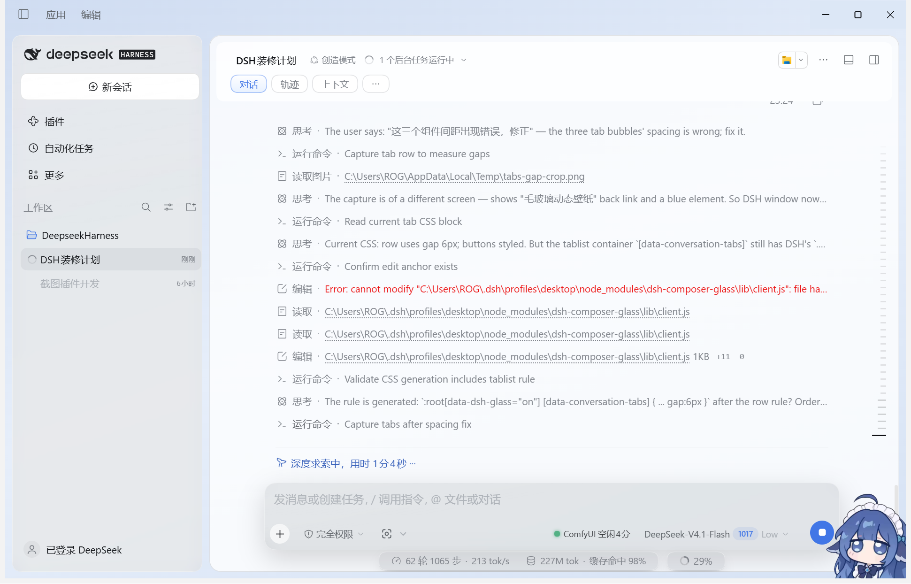

# dsh-glass-suite

DeepSeek Harness 的**整套毛玻璃外壳**插件：把侧栏、会话列、右侧栏做成三张圆角玻璃卡，配上淡蓝渐变底、10px 缝隙、悬浮页签气泡、无边框会话头部，同时保留原来的输入框 / 浮动面板 / 弹窗磨砂材质与可选动态壁纸。



## 这个插件解决什么问题

以前这套界面分两处改：

- `dsh-composer-glass`：输入框、浮动件、侧栏、弹窗等表面的磨砂材质（npm 官方包）；
- `@local/dsh-glass-frames`：外壳（渐变底、三列玻璃卡、页签气泡、头部去边线）。

第二份是直接改第一份 `lib/client.js` 得来的。pnpm 每次重装或升级 `dsh-composer-glass`，补丁就被官方原版覆盖，玻璃界面随即消失。

现在两者合并成这一个插件：外壳样式以独立模块注入，**不改任何第三方包的文件**，重装别的插件也不会丢。要调整外观，改 `lib/client.js` 里的 `FRAMES_CSS` 即可，约 20 秒热重载。

## 两层结构

| 层 | 来源 | 作用 |
|---|---|---|
| 外壳层 `FRAMES_CSS` | 本仓库（原 dsh-glass-frames） | 淡蓝渐变底、三列 16px 圆角玻璃卡 + 10px 缝隙、悬浮页签气泡、无边框会话头部、去掉侧栏黑色提示框与快捷键芯片 |
| 材质层 | 上游 `dsh-composer-glass` 1.1.1（MIT） | 输入卡、浮动面板、状态胶囊、侧栏、内容表面、弹窗的磨砂材质；可选图片 / 视频壁纸 |

外壳层挂在 `html[data-glass-frames="on"]` 下，材质层挂在自己的 `data-dsh-glass` 作用域下；任一层失效，另一层照常工作。

## 安装

本地开发（本机正在用这种方式）：

```jsonc
// <profile>/package.json
"dependencies": { "dsh-glass-suite": "link:D:/DeepseekHarness/.dsh-plugins/dsh-glass-suite" },
"dsh": { "profile": { "bundles": ["...", "dsh-glass-suite"] } }
```

也可以把整个目录放进 profile 的 `node_modules`，再把包名加进 `dsh.profile.bundles`。装好必须**完全退出** DeepSeek Harness 再打开，因为客户端 bundle 只在冷启动时重新做快照。

## 配置

设置页里能看到「毛玻璃」相关项（壁纸开关、适配方式、压暗程度）。默认壁纸关闭，只保留材质。

## 目录

```
lib/index.js      宿主半侧（沿用上游实现，负责壁纸与配置）
lib/client.js     浏览器半侧：上游玻璃材质 + 本仓库追加的外壳层
locale/           中英文文案
images/           图标与壁纸素材
cordis.patch.yml  bundle patch：注册 id=glass-suite
NOTICE.md         上游 MIT 归属说明
```

## 许可

MIT。合并进来的 `dsh-composer-glass` 代码版权归其作者，见 `NOTICE.md` 与 `LICENSE`。
